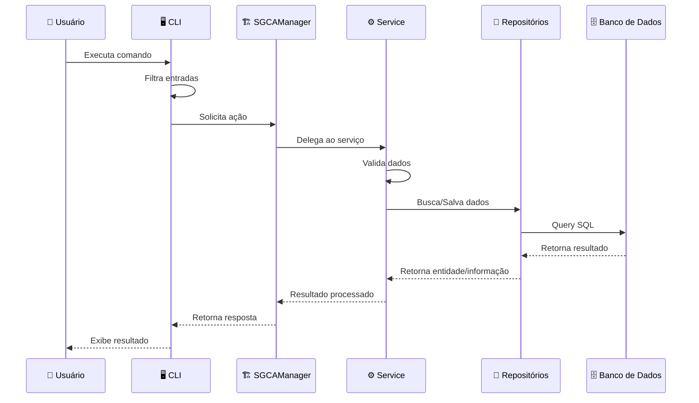

# SGCA — Sistema de Gerenciamento de Cursos e Alunos

Sistema desenvolvido para avaliação acadêmica durante o curso de Engenharia de Software.

## Objetivo

SGCA é uma aplicação com arquitetura em camadas que gerencia dados acadêmicos através de uma interface CLI. O sistema almeja princípios independência entre as camadas, com isolamento dos dados de armazenamento persistente, utilizando a estruturação para apresentação, serviços, persistência e domínio.
## Utilização

### O código do projeto
O comando para obter o código do projeto é esse:
```bash
git clone https://github.com/Raimundo77733/SGCA.git
```
### Criando um ambiente virtual no Linux
Agora no diretório do projeto execute
```bash
python -m venv --upgrade-deps venv #Cria um ambiente virtual chamado venv, pode ser renomeado mudando o segundo venv
source venv/bin/activate #O arquivo para mudança de ambiente muda dependendo do shell e do sistema operacional
```
```bash
pip install -r requirements.txt
```
O projeto já está funcional, navegue até a pasta src(source) dentro do projeto

```bash
python cli.py acad -h                 # Utilize esse comando para mostra a ajuda da interface
```
Para um uso detalhado de todas as funções e argumentos dos comandos veja o guia:

<h1><a href="./docs/cli.md" style="color: purple;">Comandos CLI</a></h1>


## Funcionalidades

- Cadastro, edição e exclusão de alunos
- Cadastro e gerenciamento de cursos
- Controle de matrículas
- Consulta de alunos e cursos
- Gerenciamento de informações acadêmicas
- Relatórios de performance dos estudantes

## Tecnologias utilizadas

- **Backend:** `<python>`
- **Banco de dados:** `<Sqllite3>`
- **Testes:** `<pytest>`

### Camadas

| Camada | Responsabilidade | Arquivos |
|--------|------------------|----------|
| **CLI** | Interface com usuário | `cli.py` |
| **Facade** | Unificação dos serviços para a CLI| `facades/SGCAManager.py`, `bootstrap.py` |
| **Services** | Controle do acesso ao banco de dados | `services/` |
| **Repositories** | Acesso a dados | `repositories/` |
| **Domain** | Entidades  | `domain/` |
| **Models** | Interação com a database | `models/` |
| **Errors** | Tratamento de erros | `errors/` |
| **Utils** | Utilitários | `utils/` |

## Testes
Os arquivos de testes estão na pasta teste e devem ser executados em ordem test_1 e test_2, eles são relacionados a população da database e matricula dos alunos e teste das regras de negócio respectivamente.
Para testar entre no diretório raíz do projeto, SGCA e execute: 
```
pytest tests/test_1_populate.py -v
pytest tests/test_2_regras.py.py -v
```
Utilizando somente esses testes o caminho da database não é especificado e estará no diretório padrão em data, caso queria refazer exclua a database ou mova-a
## 📁 Estrutura de Diretórios
```
├── src
│   ├── cli.py
│   ├── data
│   │   └── sgca.db
│   ├── domain
│   │   ├── Aluno.py
│   │   ├── Curso.py
│   │   ├── Matricula.py
│   │   ├── Oferta.py
│   │   ├── Pessoa.py
│   │   ├── Turma.py
│   │   └── __init__.py
│   ├── errors
│   │   ├── DatabaseErrors.py
│   │   ├── UnauthorizedError.py
│   │   ├── Validation.py
│   │   └── __init__.py
│   ├── facades
│   │   ├── SGCAManager.py
│   │   ├── __init__.py
│   │   └── bootstrap.py
│   ├── models
│   │   ├── __init__.py
│   │   ├── banco.py
│   │   ├── base.py
│   │   └── schema.py
│   ├── repositories
│   │   ├── __init__.py
│   │   ├── aluno_repo.py
│   │   ├── curso_repo.py
│   │   ├── disciplina_repo.py
│   │   ├── historico_repo.py
│   │   ├── matricula_repo.py
│   │   └── turma_repo.py
│   ├── services
│   │   ├── __init__.py
│   │   ├── cadastro_service.py
│   │   ├── matricula_service.py
│   │   └── relatorio_service.py
│   └── utils
│       ├── __init__.py
│       ├── determinar_tipo_erro.py
│       ├── horario.py
│       ├── settings.json
│       ├── settings_load.py
│       └── texto_data_convert.py
└── tests
    ├── helpers.py
    ├── test_1_populate.py
    └── test_2_regras.py
```
## Diagrama UML de fluxo de dados


## Classes Base
1. Oferta (classe base para ofertas)
   - Subclasse: Turma

2. Pessoa (classe base para pessoas)
   - Subclasses: Aluno

## Classes Principais
3. Turma (herda de Oferta)
   - Atributos: id_disciplina, nome_disciplina, cod_curso, nome_curso, carga_horaria, creditos, horarios, intervalos, vagas_max, inscritos, id_turma, status, local, semestre,data_limite
   - Métodos:
     - intervalos()
     - tem_choque_com()
     - __str__ ()
     - __len__()
     

4. Aluno (herda de Pessoa)
   - Atributos: nome, email,_n_matricula,cod_curso,nome_curso,_status_curso,_cr
   - Métodos:
     - __str__()
     - __bool__()
     - __gt__()
     - __lt__()
     - property _status_curso
     - property _matricula
     - property _cr
5. Curso
   - Atributos: nome_curso,cod_curso,carga_horaria,disciplinas
   - Métodos:
     - property cod_curso(validação)
     

6. Matricula (aluno, turma)
   - Atributos: n_matricula,id_turma,media,notas,frequencia_media,registro_frequencia,_status
   - Métodos:
        - verificar_vagas()
       - verificar_choque_horario()
       - _verificar_cursando()
       - lancar_nota()
       - lancar_frequencia()
       - calcular_situacao()
       - property  _status 


## Relação entre as classes
- As classes de erros são utilizadas para ajudar a identificar erros em determinadas partes do programa
- A classe Turma funciona como um link entre as tabela de disciplinas cadastradas
- A classe Matrícula tem a função de ligar o aluno e a turma e posteriormente se torna um registro na tabela do histórico
- A classe gerenciadora SGCAManager unifica os serviços para a chamada no arquivo da CLI 
- As classes de repositórios interagem com o banco de dados herdando funções e métodos dos modelos genéricos de CRUD que existem na classe Repositorio em base.py
- A classe Banco faz as transações e é o ponto real de interação com o banco de dados
